<h2><u><strong>Logging in to IRIS from VS Code with OAuth2</strong></u></h2>

As of IRIS 2025.2, OAuth2 is a native authentication type for web applications: a client presents an access token from your identity provider, and IRIS validates it and turns its claims into an IRIS user with roles. No custom login code is needed.

This article applies that to a client you use every day: <strong>VS Code</strong>. Since version 3.14, the InterSystems Server Manager extension can sign in to IRIS with OAuth2. You log in once in the browser with your identity provider, and VS Code uses the resulting access token for every request it sends to IRIS. There is no IRIS password in your <code>settings.json</code>, and no IRIS password at all for the developer.

The setup is small: Keycloak comes pre-configured, and on the IRIS side you create a server description, a resource server, and one web application setting. No ObjectScript is required.

<h3>How it fits together</h3>
<ul>
<li><strong>Client:</strong> VS Code (InterSystems Server Manager). It runs the login in your browser using the authorization code flow with PKCE.</li>
<li><strong>Authorization Server:</strong> Keycloak. It authenticates the developer and issues the access token.</li>
<li><strong>Resource Server:</strong> IRIS, specifically the <code>/api/atelier</code> web application, which is the REST API VS Code uses for everything (browsing namespaces, opening and saving classes, compiling).</li>
</ul>

Every request from VS Code to <code>/api/atelier</code> carries <code>Authorization: Bearer &lt;token&gt;</code>. IRIS validates the token and maps its claims to an IRIS username and roles.

<h3>Prerequisites</h3>

<strong>Note:</strong> This demo uses HTTP to keep the setup simple. In production, use HTTPS everywhere; an access token is as good as a password while it is valid.

<ul>
<li>Docker, VS Code, and the <a href="https://marketplace.visualstudio.com/items?itemName=intersystems-community.servermanager" target="_blank">InterSystems Server Manager</a> extension, version <strong>3.14 or later</strong>.</li>
<li>A hosts entry for Keycloak. Add this line to <em>C:\Windows\System32\drivers\etc\hosts</em> (Windows) or <em>/etc/hosts</em> (Linux/Mac):
<blockquote>
127.0.0.1 keycloak
</blockquote>
The token's issuer (<code>iss</code>) must be identical for VS Code, which runs on your machine, and for IRIS, which runs in a container. Using the name <code>keycloak</code> in both places guarantees that.</li>
<li>Ports 8080 (Keycloak) and 52773 (IRIS) free on your machine. Stop any other container or local service using them.</li>
</ul>

Clone the repository and start the two containers (Keycloak takes a few seconds to come up):

<pre class="codeblock-container" idlang="0" lang="Shell" tabsize="4"><code class="language-bash">git clone https://github.com/Ari-Glikman/OAuth2-VSCode-Login
cd OAuth2-VSCode-Login
docker compose up -d</code></pre>

The IRIS Management Portal is at <a href="http://localhost:52773/csp/sys/UtilHome.csp" target="_blank">http://localhost:52773/csp/sys/UtilHome.csp</a> (<code>_SYSTEM</code> / <code>SYS</code>). The compose file keeps the default passwords for this demo, so there's no password-change prompt. <code>SuperUser</code> and <code>Admin</code> also use <code>SYS</code>.

<h3>Behind the scenes: the Authorization Server (Keycloak)</h3>

You don't need to do anything in Keycloak: <code>docker compose up</code> imports the realm in <code>keycloak/realm-vscode.json</code>. Explaining Keycloak itself is out of scope, but it's worth knowing what that realm contains. These are the settings to reproduce in your own identity provider:

<ul>
<li><strong>Realm <code>vscode</code>.</strong> Its issuer, <code>http://keycloak:8080/realms/vscode</code>, is the URL both IRIS and VS Code use.</li>
<li><strong>Client <code>vscode-iris</code>: public, with PKCE (S256).</strong> VS Code is a desktop application and can't keep a client secret, so Server Manager never sends one. If the client required authentication, the login would succeed in the browser and then fail with <em>Invalid client or Invalid client credentials</em>.</li>
<li><strong>Valid redirect URI <code>vscode://intersystems-community.servermanager/oauth2-callback</code>.</strong> After you log in, Keycloak redirects your browser to this URI and the operating system hands it to VS Code. It never travels over the network, so it works wherever Keycloak runs.</li>
<li><strong>An Audience mapper</strong> adding <code>http://localhost:52773/</code> to the token's <code>aud</code> claim. IRIS only accepts tokens addressed to it. Server Manager asks for an audience equal to the server's URL (<code>&lt;scheme&gt;://&lt;host&gt;:&lt;port&gt;/</code>), but Keycloak ignores that request parameter; without the mapper the token's audience is just <code>account</code> and IRIS rejects it. (In Keycloak it's the mapper type <em>Audience</em>, not the similarly named <em>Audience Resolve</em>.)</li>
<li><strong>A User Realm Role mapper</strong> copying the user's realm roles into a top-level claim, <code>iris_roles</code>. Keycloak normally nests them inside <code>realm_access.roles</code>, which IRIS's built-in authenticator can't read.</li>
<li><strong>User <code>dev1</code> / <code>123</code></strong>, holding the realm role <code>iris:%Developer</code>. Step 2 explains the <code>iris:</code> prefix.</li>
</ul>

To look around, the admin console is at <a href="http://keycloak:8080/admin/" target="_blank">http://keycloak:8080/admin/</a> (<code>admin</code> / <code>admin</code>), realm <code>vscode</code>, client <code>vscode-iris</code>.

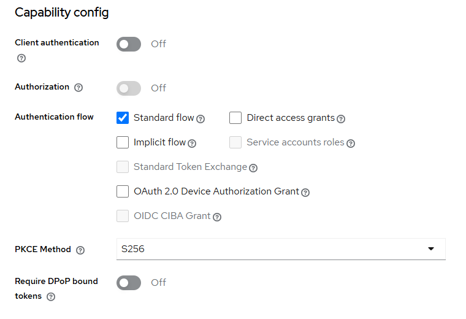

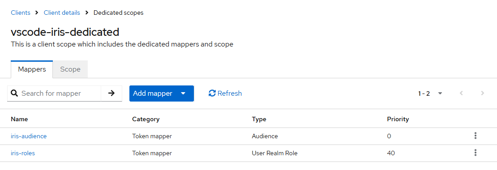

<h3>Step 1: Tell IRIS who the Authorization Server is</h3>
<ol>
<li><strong>An SSL/TLS configuration.</strong> <em>System Administration &gt; Security &gt; SSL/TLS Configurations &gt; Create New Configuration</em>: name it <code>keycloak</code>, type <em>Client</em>, keep the defaults, and save. 
The portal won't run discovery without one, even though this demo's issuer is plain <code>http://</code>; it answers <em>SSL/TLS configuration must be specified for discovery request</em>. Over <code>http://</code> the configuration is never used. With an <code>https://</code> issuer, as in production, it's where you make IRIS trust your identity provider's certificate.

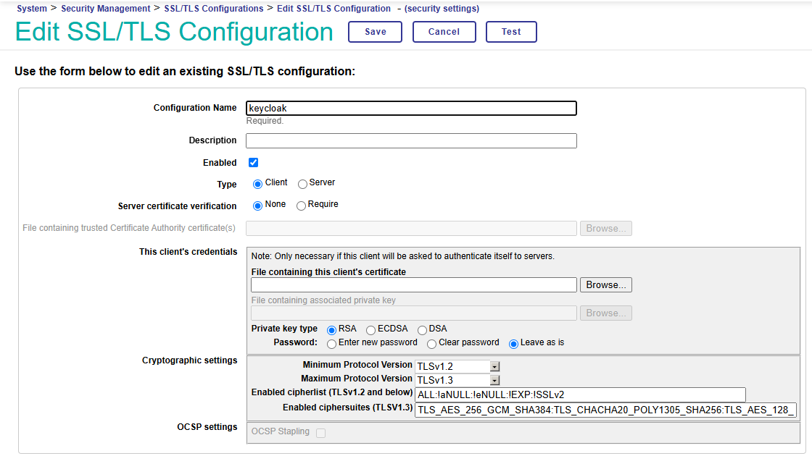
</li>
<li><strong>The server description.</strong> <em>System Administration &gt; Security &gt; OAuth 2.0 &gt; Client</em>, <em>Create Server Description</em>: Issuer <code>http://keycloak:8080/realms/vscode</code>, SSL/TLS configuration <code>keycloak</code>, then <em>Discover and Save</em>. IRIS downloads the realm's metadata: its endpoints and the keys it signs tokens with.

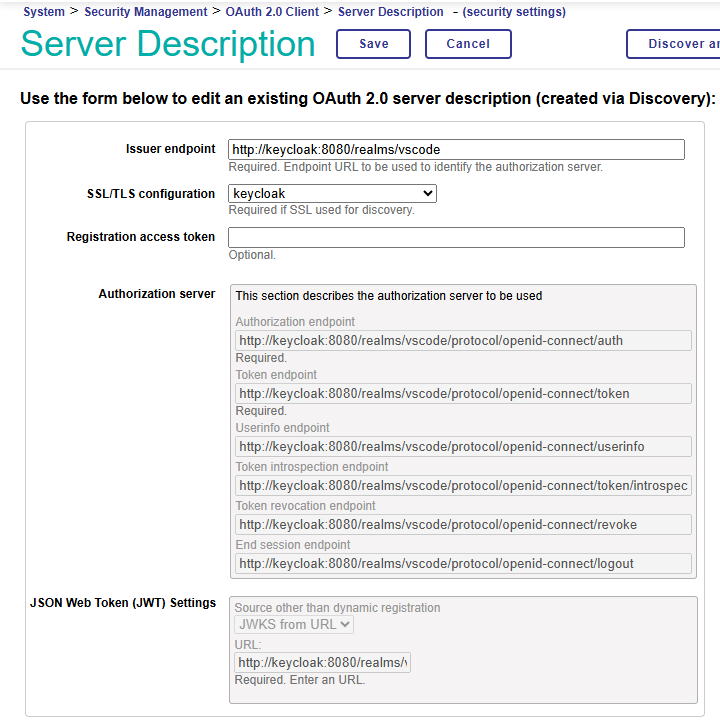
</li>
</ol>

<h3>Step 2: Create the Resource Server</h3>

<em>System Administration &gt; Security &gt; OAuth 2.0 &gt; Resource Server</em>, <em>Create Resource Server</em>:

<ul>
<li><strong>Name:</strong> <code>VSCode Resource Server</code></li>
<li><strong>Server Definition:</strong> <code>http://keycloak:8080/realms/vscode</code></li>
<li><strong>Audiences:</strong> click <em>Add</em>, enter <code>http://localhost:52773/</code> and click <em>OK</em>. It's the same value as the Keycloak mapper, including the trailing slash.</li>
<li><strong>Access Token Validation:</strong> leave <em>JWT</em> checked (the default). IRIS validates the token's signature itself, with the keys it got during discovery.</li>
<li><strong>Authenticator:</strong> Namespace <code>%SYS</code>, Implementation <code>%OAuth2.ResourceServer.SimpleAuthenticator</code>, and
  <ul>
  <li><em>Prefix</em>: <code>iris:</code></li>
  <li><em>RoleClaim</em>: <code>iris_roles</code></li>
  <li><em>UserClaim</em>: <code>preferred_username</code></li>
  </ul></li>
</ul>

The authenticator decides which IRIS user and roles a token becomes. You can write your own by subclassing <code>%OAuth2.ResourceServer.Authenticator</code>, but the built-in one is enough here. The <strong>prefix</strong> does two jobs: it ignores every role that doesn't start with <code>iris:</code> (Keycloak adds its own, such as <code>offline_access</code>), and it strips the prefix from the ones that do. <code>iris:%Developer</code> in Keycloak becomes the IRIS role <code>%Developer</code>.

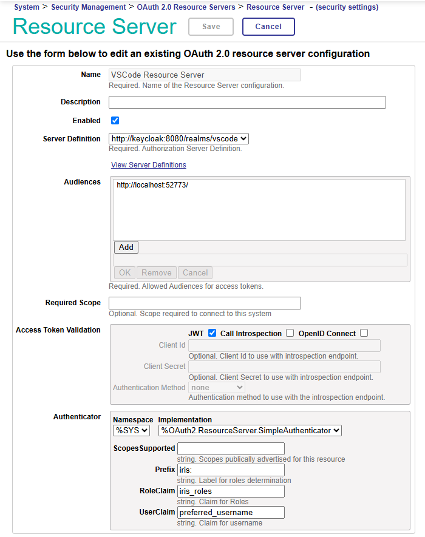

You don't tell IRIS which web applications use this resource server: the first one you save becomes the default for all of them (and for SQL connections). It only comes into play for an application once you enable OAuth2 on it, which is the next step.

<h3>Step 3: Enable OAuth2 on /api/atelier</h3>

First allow OAuth2 system-wide (once per instance): <em>System Administration &gt; Security &gt; System Security &gt; Authentication/Web Session Options</em>, check <em>Allow OAuth2 authentication</em>.

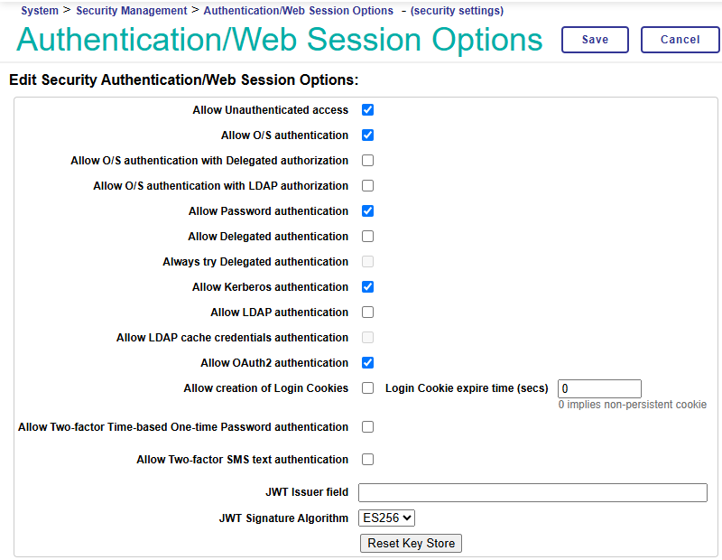

Then open <em>System Administration &gt; Security &gt; Applications &gt; Web Applications &gt; /api/atelier</em>. Under <em>Allowed Authentication Methods</em>, check <strong>OAuth2</strong> and clear the others, then save.

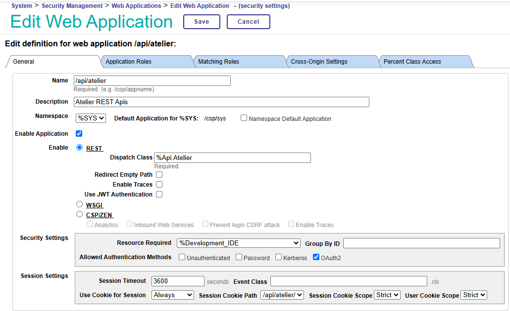

Why only OAuth2? Keep it simple: when other methods are enabled alongside it, one of them can claim the request first. For example, a <code>ZAUTHENTICATE</code> routine whose <code>GetCredentials</code> always supplies credentials makes Delegated win, and the token is never looked at.

<h3>Step 4: Sign in from VS Code</h3>

In the InterSystems view, add a server (<em>+</em> on the Servers list). Give it a name, <code>oauth-demo</code>, and the URL <code>http://localhost:52773/</code>. Server Manager then asks how to authenticate:

<ol>
<li>For the authentication method, choose <strong>OAuth2</strong>.

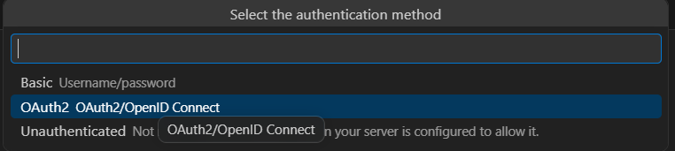
</li>
<li>For the OAuth2 authority URL, enter the issuer <code>http://keycloak:8080/realms/vscode</code>.

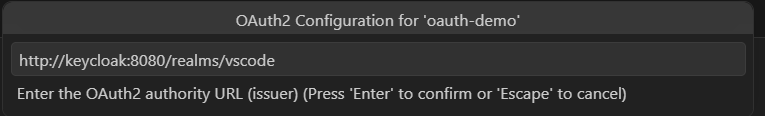
</li>
<li>For the client ID, enter <code>vscode-iris</code>.

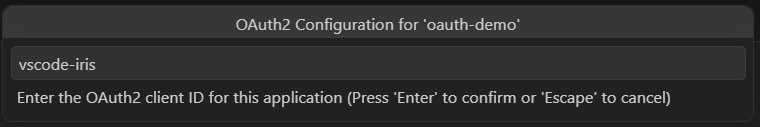
</li>
</ol>

That's all VS Code needs. It stores the server in your user <code>settings.json</code> as an entry like the one below, so you can also write it by hand instead. The new part is the <code>oauth2</code> block.

<pre class="codeblock-container" idlang="3" lang="JSON" tabsize="4"><code class="language-json">{
  "intersystems.servers": {
    "oauth-demo": {
      "webServer": {
        "scheme": "http",
        "host": "localhost",
        "port": 52773
      },
      "oauth2": {
        "authority": "http://keycloak:8080/realms/vscode",
        "clientId": "vscode-iris"
      },
      "description": "IRIS with OAuth2 (Keycloak)"
    }
  }
}</code></pre>

In the InterSystems view, expand <em>oauth-demo</em>. VS Code opens your browser at the Keycloak login page; sign in as <code>dev1</code> / <code>123</code>, allow the browser to open VS Code, and the server's namespaces appear.

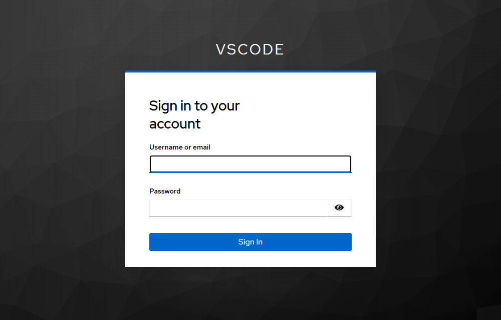

<!-- screenshot: Server Manager tree showing namespaces -->

In the Management Portal, under <em>Security &gt; Users</em>, you will now find the user <code>dev1</code> with the role <code>%Developer</code>. IRIS created it from the token's claims on the first request; its type is <em>OAuth2 user</em>.

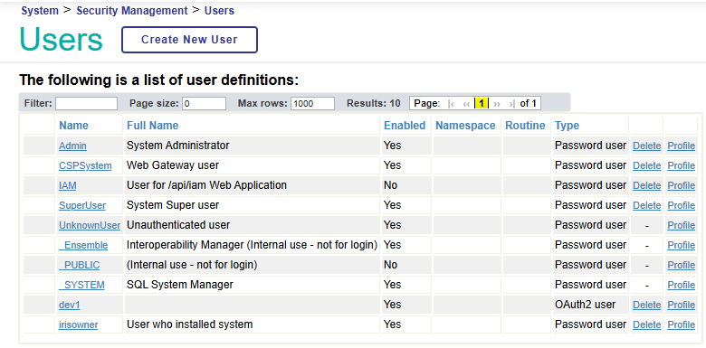

<h3>Troubleshooting</h3>
<ul>
<li><strong>Keycloak says <em>Invalid parameter: redirect_uri</em>.</strong> The client's <em>Valid redirect URIs</em> doesn't contain <code>vscode://intersystems-community.servermanager/oauth2-callback</code>.</li>
<li><strong>VS Code says <em>Token exchange failed - Invalid client or Invalid client credentials</em>.</strong> The Keycloak client still requires client authentication. Make it public.</li>
<li><strong>Login works, IRIS answers 401.</strong> Check the audit log (<em>System Administration &gt; Security &gt; Auditing &gt; View Audit Database</em>, event <em>LoginFailure</em>). Its message tells you which part failed:
  <ul>
  <li><em>Delegated login failed</em>: another method on <code>/api/atelier</code> claimed the request. Make OAuth2 the only one.</li>
  <li><em>ERROR #936: User ... is not an OAuth2 user</em>: an IRIS user with that name already exists and was created by a different login method (for example, Delegated). Use another username or a prefix, or remove the old user.</li>
  <li>An audience or issuer mismatch on an instance that already had a resource server: the first one saved is the default for every web application, so <code>/api/atelier</code> may be using the old one. Point <code>/api/atelier</code> at the new one from an IRIS terminal in <code>%SYS</code>: 
  <code>do ##class(OAuth2.ResourceServer.Mapping).Create("%Service_WebGateway","/api/atelier",##class(OAuth2.ResourceServer).%OpenId("VSCode Resource Server"))</code></li>
  <li>A token audience or issuer error: compare the token's <code>aud</code> and <code>iss</code> (paste it into a JWT decoder) with the resource server's Audiences and the server description's issuer. They must match exactly, trailing slash included.</li>
  </ul></li>
<li><strong>VS Code doesn't prompt you and still gets 401.</strong> It reuses its cached session. Sign out using the Accounts icon (bottom left) &gt; InterSystems Server Credentials, then connect again.</li>
<li><strong>VS Code says <em>OAuth2: Failed to discover endpoints from http://keycloak:8080/realms/vscode/.well-known/openid-configuration</em>, and no browser opens.</strong> VS Code itself contacts Keycloak (for discovery, and later for the token exchange), so the <code>127.0.0.1 keycloak</code> hosts entry is missing, or Keycloak is still starting.</li>
</ul>

<h3>Wrapping up</h3>

Three IRIS building blocks, a server description, a resource server, and OAuth2 on a web application, are all it takes to protect the API VS Code talks to. The result: developers sign in to IRIS with the same identity provider they use for everything else, roles come from that identity provider, and no IRIS passwords live on developer machines.

<strong>Related:</strong> to protect your own REST APIs the same way, with roles derived from OAuth2 scopes and a custom authenticator class, see <a href="https://openexchange.intersystems.com/package/OAuth2-Native-Authentication-for-Web-Applications" target="_blank">OAuth2 Native Authentication for Web Applications</a>.

